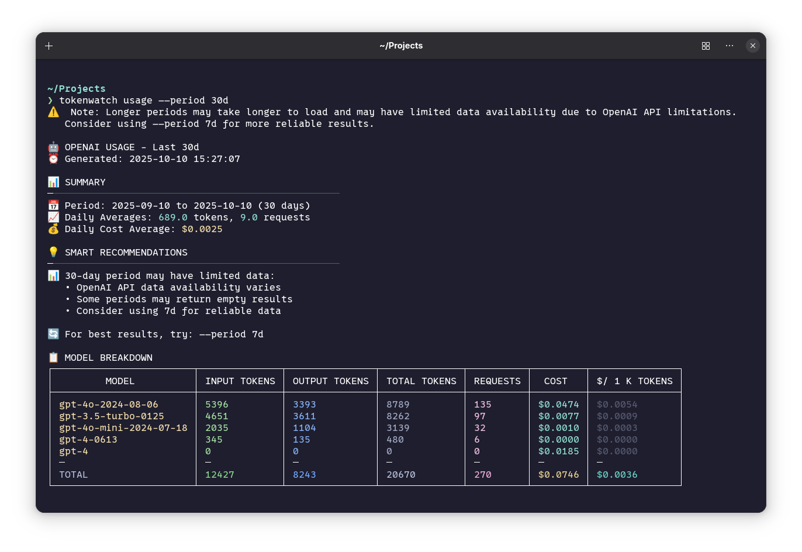

# TokenWatch CLI 🚀

A simple and focused CLI tool for monitoring OpenAI token usage and costs with real-time capabilities.

[](https://golang.org)
[](LICENSE)
[](https://openai.com)

## ✨ Features

- **🤖 OpenAI Monitoring**: Track token consumption and costs across all models
- **⏰ Real-time Watch Mode**: Monitor usage with 30-second auto-refresh
- **📊 Smart Periods**: 1-day (recent), 7-day (historical), 30-day (extended)
- **🔍 Debug Mode**: Detailed API request/response logging for troubleshooting
- **💾 Intelligent Caching**: 5-minute cache with watch mode bypass
- **🔄 Resilience**: Rate limiting, circuit breaker, and automatic retries
- **🎨 Beautiful Output**: Colorful terminal tables with model breakdowns

## 🚀 Quick Start

```bash
# 1. Install TokenWatch (choose method below)
# 2. Setup your OpenAI API key
tokenwatch setup

# 3. Start monitoring
tokenwatch usage                    # Last 7 days
tokenwatch usage --period 1d       # Last 24 hours
tokenwatch usage -w -p 1d          # Watch mode for real-time updates
```

## 📖 What It Does

TokenWatch CLI provides comprehensive monitoring of your OpenAI API usage:

- **Token Consumption**: Input, output, and total tokens per model
- **Cost Analysis**: Real-time cost tracking and daily averages
- **Model Breakdown**: Detailed usage statistics for each model
- **Smart Recommendations**: Period-specific guidance for optimal monitoring
- **Real-time Updates**: Watch mode for continuous monitoring

## 🛠️ Installation

### Option 1: Download Pre-built Binary (Recommended for Users)

**This is the easiest way to get started - no Go installation required!**

1. **Go to [Releases](https://github.com/mboss37/tokenwatch/releases)**
2. **Download v0.1.0** for your platform:
   - **Linux (x64)**: `tokenwatch-linux-amd64`
   - **Linux (ARM64)**: `tokenwatch-linux-arm64`
   - **macOS (Intel)**: `tokenwatch-darwin-amd64`
   - **macOS (Apple Silicon)**: `tokenwatch-darwin-arm64`
   - **Windows**: `tokenwatch-windows-amd64.exe`

#### **Install Commands**

**Linux/macOS:**
```bash
# Download the binary
wget https://github.com/mboss37/tokenwatch/releases/download/v0.1.3/tokenwatch-linux-amd64

# Make it executable
chmod +x tokenwatch-linux-amd64

# Move to a directory in your PATH
sudo mv tokenwatch-linux-amd64 /usr/local/bin/tokenwatch

# Test installation
tokenwatch --version
```

**Windows:**
```cmd
# Download the .exe file and place it in a directory in your PATH
# Or run it directly from the download location
```

### Option 2: Install via Go (If you already have Go installed)

**Requires Go 1.21+ to be installed on your system**

```bash
# Install directly from GitHub
go install github.com/mboss37/tokenwatch/cmd/root@v0.1.0

# The binary will be installed to $HOME/go/bin/
# Add to PATH if it's not already there:
export PATH="$HOME/go/bin:$PATH"

# Test installation
tokenwatch --version
```

### Option 3: Build from Source (For Developers)

**Requires Go 1.21+ and git**

```bash
# Clone the repository
git clone https://github.com/mboss37/tokenwatch.git
cd tokenwatch

# Checkout the specific version
git checkout v0.1.0

# Build the binary
go build -o tokenwatch ./cmd/root

# Make it executable
chmod +x tokenwatch

# Test the build
./tokenwatch --help

# Optionally install it
go install ./cmd/root
```

### Option 4: Using Makefile (For Developers)

**Requires Go 1.21+ and make**

```bash
# Clone the repository
git clone https://github.com/mboss37/tokenwatch.git
cd tokenwatch

# Build for your platform
make build

# Build for all platforms
make build-all

# Install locally
make install
```

## 🔧 Setup

### Requirements
- **OpenAI Admin API key** with `api.usage.read` scope
- **Organization-level access** (personal API keys won't work)

### First Time Setup
```bash
# 1. Install TokenWatch using one of the methods above
# 2. Setup your API key
tokenwatch setup

# 3. Start monitoring
tokenwatch usage                    # Last 7 days
tokenwatch usage --period 1d       # Last 24 hours
tokenwatch usage -w -p 1d          # Watch mode for real-time updates
```

## 📚 Documentation

- **[📖 User Guide](docs/USER_GUIDE.md)** - Complete usage documentation with examples
- **[🛠️ Developer Guide](docs/DEVELOPER.md)** - Contributing and architecture details

## 🔍 Basic Usage

```bash
# View OpenAI usage (last 7 days)
tokenwatch usage

# Specify time period
tokenwatch usage --period 1d       # Last 24 hours
tokenwatch usage --period 7d       # Last 7 days (default)
tokenwatch usage --period 30d      # Last 30 days

# Watch mode (works with all periods)
tokenwatch usage -w -p 1d          # Real-time updates
tokenwatch usage -w -p 7d          # Watch 7-day period

# Debug mode
tokenwatch usage --debug            # API request/response logging
```

### 📊 Example Output

Here's what TokenWatch output looks like when monitoring your OpenAI usage:



*Screenshot showing TokenWatch CLI displaying OpenAI usage statistics with a detailed breakdown of token consumption, costs, and model-specific data over a 30-day period.*

## 🏗️ Architecture

TokenWatch follows a clean, layered architecture designed for simplicity and maintainability:

```
┌─────────────────────────────────────────────────────────────┐
│                    Command Layer                            │
│  ┌─────────────────┐  ┌─────────────────┐  ┌─────────────┐ │
│  │   usage_cmd.go  │  │   setup_cmd.go  │  │ config_cmd  │ │
│  │  (OpenAI usage) │  │ (API key setup) │  │ (settings)  │ │
│  └─────────────────┘  └─────────────────┘  └─────────────┘ │
└─────────────────────────────────────────────────────────────┘
┌─────────────────────────────────────────────────────────────┐
│                   Provider Layer                            │
│  ┌─────────────────────────────────────────────────────────┐ │
│  │                openai.go                               │ │
│  │           (OpenAI API implementation)                  │ │
│  └─────────────────────────────────────────────────────────┘ │
└─────────────────────────────────────────────────────────────┘
┌─────────────────────────────────────────────────────────────┐
│                    Model Layer                              │
│  ┌─────────────────┐  ┌─────────────────┐                  │
│  │  consumption.go │  │   pricing.go    │                  │ │
│  │ (usage models)  │  │ (cost models)   │                  │ │
│  └─────────────────┘  └─────────────────┘                  │ │
└─────────────────────────────────────────────────────────────┘
```

## 🤝 Contributing

We welcome contributions! Please see our [Contributing Guidelines](CONTRIBUTING.md) and [Developer Guide](docs/DEVELOPER.md) for details.

### Development Setup

```bash
# Clone and setup
git clone https://github.com/mboss37/tokenwatch.git
cd tokenwatch
go mod tidy

# Build and test
go build -o tokenwatch ./cmd/root
go test ./...

# Install locally
go install ./cmd/root
```

## 📄 License

This project is licensed under the MIT License - see the [LICENSE](LICENSE) file for details.

## 🙏 Acknowledgments

- Built with [Cobra](https://github.com/spf13/cobra) for CLI framework
- Uses [Viper](https://github.com/spf13/viper) for configuration
- Terminal tables powered by [tablewriter](https://github.com/olekukonko/tablewriter)
- Colors provided by [fatih/color](https://github.com/fatih/color)

## 📞 Support

- **Documentation**: [User Guide](docs/USER_GUIDE.md) | [Developer Guide](docs/DEVELOPER.md)
- **Issues**: [GitHub Issues](https://github.com/mboss37/tokenwatch/issues)
- **Discussions**: [GitHub Discussions](https://github.com/mboss37/tokenwatch/discussions)
- **Repository**: [https://github.com/mboss37/tokenwatch](https://github.com/mboss37/tokenwatch)

---

**Happy monitoring! 🚀**

*For detailed usage instructions, examples, and troubleshooting, see the [User Guide](docs/USER_GUIDE.md).*